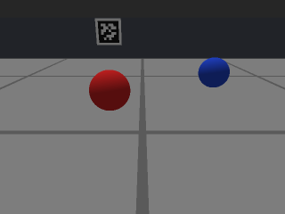

# `vision`

`org.horizon36596.simloop.vision`

!!! note "Development APIs"
    Distortion, `CameraOccluders`, tilted tags and synthetic frames were added after the
    `v0.2.0-alpha.1` tag. The pinned alpha does not contain them. Use documentation from the tag you
    install; for development work, pin the exact source commit you tested. See
    [Installing it](../getting-started.md).

A simulated camera on the robot, at two levels:

- **Geometry.** Which game pieces and AprilTags fall inside the image and where, as numbers. Through a
  pinhole or a distorted lens, with field structures, the robot's own body and other pieces in the way.
  For testing the geometry half of a vision pipeline: which pixel is which point on the floor, tracking,
  and pose from tags.
- **Synthetic frames.** The same scene drawn as RGB pixels (`SimFrameRenderer`), so a real pixel pipeline
  (an OpenCV `VisionProcessor`, a colour-blob detector, a contour splitter) can run unchanged in the sim.
  **A synthetic frame is a drawing, not a photograph.** Use it to check code paths and geometry. Never
  tune a colour threshold on it.

## What you use

| Type | What it is |
|---|---|
| `CameraLens` | The intrinsics: focal lengths, principal point, image size and, optionally, OpenCV's five distortion coefficients. An OpenCV camera matrix plus `distCoeffs`. |
| `CameraMount` | The extrinsics: where the lens sits on the robot and which way it points. |
| `CameraOccluders` | Solid boxes the camera cannot see through: field boxes (field frame) and robot boxes (robot frame, they turn with the robot). |
| `SimCamera` | Sees game pieces. Returns `CameraSighting`s. |
| `CameraSighting` | One piece in the image: centre pixel, apparent radius, range, kind, clipped or not, and how much of it is visible. |
| `AprilTagLayout` | Where every tag on your field is, plumb or tilted. **You supply it.** |
| `SimTagCamera` | Sees AprilTags. Returns `TagSighting`s. |
| `TagSighting` | One tag: `tx`/`ty` in degrees, centre and corner pixels, range, area, camera-to-tag and robot-to-tag transforms. |
| `SimFrameRenderer` | Draws the scene as a `SimFrame`: floor tiles, boxes, pieces as shaded spheres, tags. |
| `SimFrame` | One synthetic frame: RGB bytes, a ground-truth piece and tag label per pixel, and a PNG writer. |
| `FrameStyle` | The flat colours and the one light frames are painted with. |
| `RigidTransform3`, `RobotFramePoint` | A 3-D rotation plus translation, and a point on the floor in the robot frame. |

`FakeLimelight3A` in [`fakehardware`](fakehardware.md) is built on `SimTagCamera`, so a Limelight and a
plain camera share one description.

### Choose the output your test needs

| What you are testing | Use | What the test receives |
|---|---|---|
| Projection, tracking or tag transforms | `SimCamera` or `SimTagCamera` | Sightings and geometry, without rendering pixels |
| Code that calls the SDK's Limelight API | `FakeLimelight3A` | SDK result objects, with configured latency, noise and dropouts |
| A colour or contour processor | `SimFrameRenderer` | RGB or RGBA bytes and per-pixel ground truth |

Use the geometry APIs when pixels are not part of the code under test. Synthetic tag patterns are
not decodable AprilTags; use tag sightings or the Limelight fake for tag-result handling.

## How it is used

From `src/test/java/org/horizon36596/simloop/vision/SimCameraTest.java`: a 70 degree, 640 x 400 camera,
6 in forward, 10 in up, tilted 22 degrees down.

```java
CameraLens lens = CameraLens.fromHorizontalFov(70.0, 640, 400);
CameraMount front = CameraMount.front(6.0, 10.0, 22.0);
SimCamera camera = new SimCamera("front", lens, front);

GamePieceTracker tracker = new GamePieceTracker(4, FieldWorld.unbounded());
tracker.updateRobotPose(0.0, 0.0, 0.0);
tracker.addLoosePiece("piece", 30.0, 0.0, 1.4);

// each tick, after the pieces and the robot have moved:
List<CameraSighting> seen = camera.observe(tracker.getPieces(), 0.0, 0.0, 0.0);
camera.record("Vision", tracker.getPieces());   // logs the camera pose and the sightings
```

To check a pipeline's projection, intersect the sighting's centre ray with the plane through the
piece's centre. The last argument is that plane's height above the floor in inches; for a ball resting
on the floor, it is the ball's radius. A frame can contain no sightings, so check the list first:

```java
if (!seen.isEmpty()) {
    CameraSighting s = seen.get(0);
    RobotFramePoint p = camera.groundPointInRobotFrame(
            s.getCentreXPx(), s.getCentreYPx(), 1.4); // centre-plane height, inches
    // p can be null if the ray does not reach the plane.
    // Otherwise compare it with the true position in the ROBOT frame, not the field frame.
}
```

### A distorted lens

Give the lens your camera's calibration, in OpenCV's order (`k1, k2, p1, p2, k3`). Every camera in this
package then projects through it, and `groundPointInRobotFrame` undistorts first, as a calibrated
pipeline does:

```java
CameraLens calibrated = new CameraLens(fx, fy, cx, cy, 640, 480, k1, k2, p1, p2, k3);  // YOUR calibration
// or: CameraLens.fromHorizontalFov(70.0, 640, 480).withDistortion(k1, k2, p1, p2, k3)
```

Use it to test your undistortion: let the sim lens be distorted and check that your pipeline, given the
same coefficients, still puts balls where they are, and that a pipeline that ignores them does not.

### Things in the way

Pass `CameraOccluders` to the five-argument `observe`. Field boxes are your structures; robot boxes are
your chassis, bumper or a raised arm, in the robot frame (`X` forward, `Y` left, `Z` up, origin on the
floor under the robot centre):

```java
CameraOccluders blockers = CameraOccluders.of(
        world.getObstacles(),                                             // field frame
        Arrays.asList(new ObstacleBox("arm", 8, 9, -6, 6, 2, 12)));       // robot frame: turns with the robot
List<CameraSighting> seen = camera.observe(tracker.getPieces(), x, y, heading, blockers);
```

`CameraOccluders` copies both lists. Robot-frame boxes turn with the chassis, but an arm's joint
motion does not update them automatically. Build new occluders when a mechanism or field structure
changes shape or position.

Each piece gets 19 rays spread over its disc. `getVisibleFraction()` is the share not blocked by a box or
a nearer piece, and a piece below `getMinVisibleFraction()` (default 0.5, `withMinVisibleFraction(...)`
to change) is not reported. The four-argument `observe` keeps the old rule: nothing but other pieces'
centre pixels hides anything.

### Tags

Build a layout from numbers you are entitled to use, then a `SimTagCamera` with a range window, a maximum
viewing angle and any boxes that block the view:

```java
AprilTagLayout layout = AprilTagLayout.builder()
        .addTag(1, 70.0, 30.0, 6.0, Math.PI, 4.0)   // id, x, y, z (in), facing (rad), size (in): YOUR numbers
        .addTiltedTag(2, 40.0, -20.0, 18.0, Math.PI, Math.toRadians(30.0), 4.0)   // face tilted 30 deg up
        .build();
SimTagCamera tags = new SimTagCamera(lens, front, 0.0, Double.POSITIVE_INFINITY, 90.0,
        Collections.<ObstacleBox>emptyList());
List<TagSighting> visible = tags.observe(layout, robotX, robotY, robotHeading);
List<TagSighting> notBehindTheArm = tags.observe(layout, robotX, robotY, robotHeading, blockers);
```

### Synthetic frames for a pixel pipeline

This fragment assumes you already have a tracker, robot pose, blockers, tag layout and processor.
Your test must provide OpenCV and load its native library before creating a `Mat`. SimLoop does not
install OpenCV or create a `VisionPortal`.

```java
SimFrameRenderer renderer = SimFrameRenderer.builder(lens, front)
        .style(FrameStyle.builder()
                .pieceColour("red", 0xC02020)        // made-up colours; see the warning below
                .pieceColour("blue", 0x2040C0)
                .build())
        .supersampling(2)                            // 4 rays a pixel: smooth edges
        .sensorNoise(36596, 2.0)                     // seeded; PLACEHOLDER spread, in 8-bit counts
        .build();

SimFrame frame = renderer.render(tracker.getPieces(), x, y, heading, blockers, layout);

// Your real processor, unchanged. SimLoop has no OpenCV dependency; your test has it.
// Initialise once per processor, outside the frame loop. null is suitable only if your processor
// does not use CameraCalibration; otherwise supply the calibration it expects.
processor.init(frame.getWidthPx(), frame.getHeightPx(), null);

// For each frame; captureTimeNanos comes from your simulated capture clock, in nanoseconds.
Mat rgb = new Mat(frame.getHeightPx(), frame.getWidthPx(), CvType.CV_8UC3);
try {
    rgb.put(0, 0, frame.getRgbBytes());
    processor.processFrame(rgb, captureTimeNanos);
    // Read and assert the processor's detections here, before releasing the input.
} finally {
    rgb.release();
}
```

The bytes are **RGB**, not BGR. Use `getRgbaBytes()` with `CV_8UC4` for a processor that expects RGBA,
or convert explicitly for one that expects BGR. Match the channel order used by your robot's pipeline.
Call `init` once, then `processFrame` for each capture; reinitialising per frame can erase tracking state.

Seeded noise also depends on the renderer's frame counter. To repeat a sequence byte for byte, create
a fresh renderer with the same seed and render the same scenes in the same order. Two consecutive
frames from one noisy renderer need not have identical pixels.

`SimFrame.getPieceIdAt(x, y)`, `pixelCountOfPiece(id)` and `centroidOfPiece(id)` are ground truth for
checking what the detector found. `writePng(out)` saves a frame; the PNG carries a comment saying it is
synthetic. Rendering costs tens of milliseconds a frame at 640 x 480, so keep it to the tests that need
pixels.



*A synthetic frame from `SimFrameRendererTest`: 320 x 240, two pieces, a wall box and a tag. Flat
colours, one light, no shadows. Not a camera image.*

## Units and frames

- Robot pose, piece positions, tag positions, field boxes: field frame, FTC-Cartesian, centre origin,
  **inches**, heading **radians** CCW from `+X`.
- `CameraMount` and robot boxes: **inches** in the robot frame (`+forward`, `+left`, `+up`, origin on the
  floor under the robot centre). Yaw **radians** CCW from forward. Pitch **radians**, **positive tilts
  down**. `CameraMount.front(...)` takes its pitch in **degrees**.
- Pixels: `(0, 0)` top-left, `+x` right, `+y` down (the OpenCV convention).
- Optical frame: `+x` image right, `+y` image down, `+z` along the boresight.
- Distortion coefficients: dimensionless, OpenCV's model and order, acting on normalised image
  coordinates `(X/Z, Y/Z)`.
- Colours: `0xRRGGBB`, 8 bits a channel. Sensor noise: standard deviation in 8-bit counts.
- `SimCamera.fieldPose3d(...)`: **metres**, WPILib camera axes, so AdvantageScope's 3D Field can use it
  as a camera override and look through the camera.
- Tag size: **inches**, the edge of the square a detector reports corners for. Tag tilt: **radians**, the
  face normal's angle above horizontal. `TagSighting` angles are **degrees** where the name says.

## Visibility rules

A piece is sighted when it is on the field (not held), more than its own radius in front of the lens,
inside the lens's valid radius, and its apparent disc overlaps the image. It is **clipped** when part of
the disc is outside the image. Without occluders, a piece whose centre pixel is covered by a nearer
piece's disc is not reported. With occluders, the visible-fraction rule above decides, and a box that
holds the piece (a ball in a tray) or the lens (the camera's housing) does not hide it.

A tag is seen only if, in this order: it is within range; it faces the camera within
`maxIncidenceDegrees` (a tilted tag's normal is tilted); all four corners are in front of the lens; all
four corners are inside the image, after distortion; and no box (constructor boxes, then field and robot
boxes passed to `observe`) blocks the line from the lens to any corner. `visibility(...)` tells you which
rule failed. Distortion moves the corner and centre pixels; `tx`, `ty` and the transforms stay the
undistorted geometry a calibrated detector recovers.

## Synthetic frames are not real frames

`SimFrameRenderer` draws flat colours under one light. It has no shadows, highlights, textures, motion
blur, rolling shutter, exposure time, white balance, lens blur, vignetting or compression. Its tag
interiors are a pattern made from the id, **not** a real tag family's code: a real AprilTag decoder will
not decode them, so test tag pose code with `SimTagCamera` or `FakeLimelight3A` instead.

So:

- **A colour threshold that passes on synthetic frames says nothing about real lighting.** If your
  thresholds can be exercised on synthetic frames, that shows the code path runs. It does not show the
  thresholds are right, and they must not be tuned there. Tune them on real photos from your camera.
- Pick piece colours that land inside your detector's bands so the code runs; do not move the bands to
  fit the colours.
- What synthetic frames can show: the pipeline runs end to end, a blob comes back where the piece is,
  edge-clipped and touching pieces are handled, occluded pieces are not reported, a distorted lens is
  undistorted correctly, and the whole thing is deterministic.

## What this package will not do

- **No photoreal image.** See above. Synthetic frames must never be used to tune colour thresholds.
- **No roll.** The image's horizontal stays level with the floor.
- **Only boxes, pieces and tags block the view.** Anything you do not give as a box (a curved structure,
  another robot unless you give it a box, the far wall unless you give it a box) is transparent. Boxes
  are axis-aligned, in the field frame or the robot frame.
- **Tag-on-tag occlusion is not modelled**, and a tag turned within its own plane is not modelled.
- **It ships no field.** Not this season's, not any season's. Do not build a layout or boxes from the
  FIRST field CAD: its licence forbids redistribution.
- **No noise in `SimCamera` or `SimTagCamera`.** `FakeLimelight3A` adds seeded noise and dropouts;
  `SimFrameRenderer` adds seeded pixel noise. A team's own sim glue adds detection noise on top of
  `SimCamera` if it wants it.
- **No OpenCV.** SimLoop hands you bytes; your test turns them into a `Mat`.
- **No frame timing.** `SimCamera` and `SimFrameRenderer` see the scene at the instant you call them.
  Frame rate, exposure latency and processing delay are your sim glue's job (`FakeLimelight3A` has its
  own).
